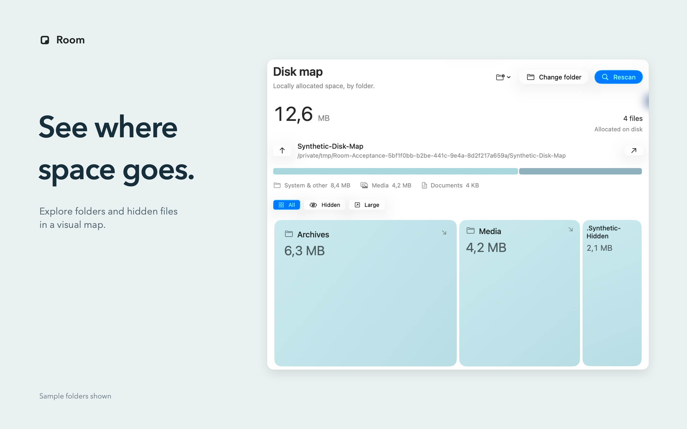

<p align="center"></p>

<h1 align="center">Room</h1>
<p align="center">Storage, clearly. A little more room for your Mac.</p>
<p align="center"><a href="https://room.merkost.dev">Website</a> · <a href="https://room.merkost.dev/support/">Support</a> · <a href="https://room.merkost.dev/privacy/">Privacy</a></p>

Room is a native macOS utility for understanding storage, reviewing developer resources, and monitoring memory. Built with SwiftUI, AppKit, and Liquid Glass. Free, with no ads or in-app purchases.



## See what is taking space

- **Clean** — measure known cache locations, distinguish clearable files from held storage, and review supported changes before moving anything to Trash.
- **Disk Map** — explore allocated space by folder, including hidden files, categories, and large items. Scan, Rescan, and Stop stay visible beside the current folder.
- **Developer** — inspect Android virtual devices and group Gradle versions with references from selected project wrappers. This view is read-only; metadata dates and missing references do not prove non-use.
- **Memory** — understand RAM, compression, swap, and memory pressure. Choose RAM or available storage for the menu bar, with configurable pressure colors and swap details.
- **Activity** — keep local cleanup receipts and restore eligible unchanged items when their original locations remain available.

Optional on-device analysis adds review suggestions when supported; local rules remain available. Suggestions do not authorize deletion. Storage scans start on demand, while the optional menu-bar monitor periodically samples memory and disk capacity.

## Two editions

| | Store | Direct |
|---|---|---|
| File access | Remembered read-only folder approvals; reviewed changes require temporary exact write grants. | Broader known-location scans, subject to macOS permissions and user-enabled Full Disk Access. |
| Cache cleanup | Old, locally verified npm download objects only. | Broader known-cache catalogue with conservative eligibility checks. |
| Memory | Monitoring and suggestions. | Monitoring plus an explicit normal app-quit review. |
| Analysis | Apple on-device models when available; local rules otherwise. | Apple models, an optional separately installed local runtime, or rules. |
| Agent worktrees | Excluded. General agent-cache cleanup is not enabled. | Separate worktree review with live remote verification and conservative holds. |

The Store cleanup exception covers supported SHA512-addressed npm download objects modified more than 30 days ago, within approved folders and bounded local verification limits. Verification does not prove an object is unused: installs may download it again, active installs may retry, and offline installs may fail. npm indexes, temporary data, installed packages, and other process-guarded caches stay held.

Cache cleanup holds unknown files, credentials, installed resources, and project source. Direct-edition worktrees have a separate explicit review before an eligible finished worktree can move to Trash. Trash retains disk space until you empty it; Room never empties Trash. Restore refuses changed files and occupied destinations. Folder approvals cover accessible descendants, while macOS protections and separate-volume approvals still apply.

## Release status

As of 22 October 2026, **Store 1.0.0 (5)** has been distribution-signed, uploaded, processed, and attached in App Store Connect. The English listing, six screenshots, and a 26-second native app preview are attached. Apple confirmed **Waiting for Review** on 22 October 2026. **Direct 1.8.0 (13)** passed its release build and native Scan/Stop checks. The website will show public Store availability after release.

Fresh tests passed for both editions: **186 Direct tests** and **171 Store tests**. Native Store 5 cleanup, Quit/relaunch, a fresh recovery write grant, and exact-byte Restore passed using disposable data. See [release evidence and boundaries](docs/RELEASE.md).

## Build

Requires an Apple silicon Mac, macOS 26+, and Xcode with Swift 6.2 or newer. The app has no external package dependencies.

```sh
# Direct edition
./scripts/build.sh

# Locally signed sandbox preview
./scripts/build-store.sh

# Tests
swift test
ROOM_EDITION=store swift test
```

The build scripts produce local candidates. Store distribution uses the separate [archive/export workflow](scripts/STORE-ARCHIVE.md) and requires the publisher’s signing assets. Tests use isolated fixtures; some exercise macOS Trash with their own temporary files.

## Design and architecture

Room uses system typography, a stable adaptive toolbar, compact numeric hierarchy, native glass controls, keyboard shortcuts, and the Mac’s Reduce Motion and Reduce Transparency preferences. The selected C4 soft-pocket mark is shared across the app and website. Cancelled scans keep partial results explicit.

`RoomCore` owns scanning, classification, cleanup, and recovery. `RoomApp` owns state, native permissions, and views. See [architecture](docs/ARCHITECTURE.md), [design](DESIGN.md), and [App Store copy](docs/APP_STORE.md). The `website/` directory contains the marketing, support, and privacy pages; it has no analytics, advertising SDK, sign-in, or third-party font dependency.

© 2026 Konstantin Merenkov. All rights reserved.
